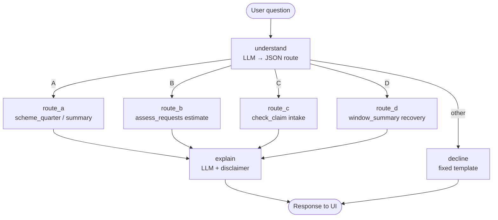
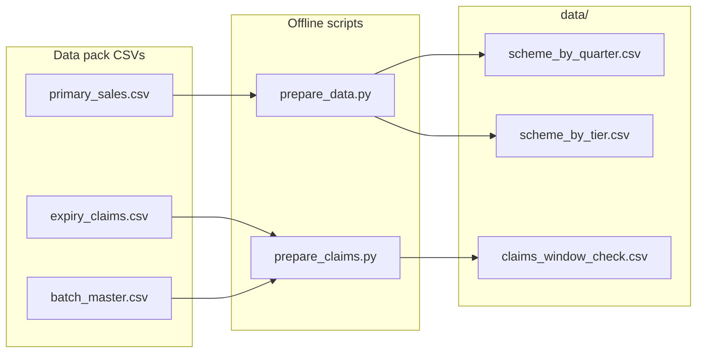
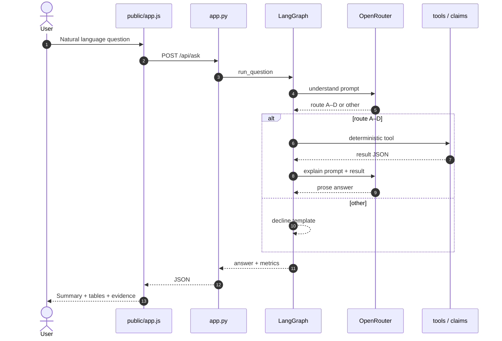

# Technical architecture note — Project Sankalp pilot

**Pfizer Limited (fictional FDE case) · General Medicines trade channel**  
**Scope:** LangGraph assistant for **scheme cap (CO-POL-014 §4.4)** and **expiry claim window (claims policy §5.2)** — not demand forecasting.

---

## 1. Purpose

Finance and sales teams need fast, policy-aligned answers before circulars go out and when reviewing past quarters or claims. The pilot keeps **all numbers in tested Python** reading prepared CSVs; the LLM only **routes** questions and **explains** tool output. A person always decides.

---

## 2. System context (runtime)

```mermaid
flowchart TB
  subgraph users["People"]
    sales["NSM / Sales"]
    fin["CFO / Controller"]
    clm["Claims team"]
  end

  subgraph browser["Browser"]
    ui["public/<br/>index.html · app.js · style.css"]
  end

  subgraph host["Vercel"]
    cdn["Static assets"]
    api["FastAPI app.py"]
  end

  subgraph pilot["Application core"]
    graph["LangGraph<br/>agent/graph.py"]
    tools["Scheme tools<br/>agent/tools.py"]
    claims["Claims tools<br/>agent/claims.py"]
    rules["Business rules<br/>agent/rules.py"]
  end

  subgraph llm_ext["Model provider"]
    or["OpenRouter API<br/>openai/gpt-4o-mini"]
  end

  subgraph store["data/ read-only at runtime"]
    sq["scheme_by_quarter.csv"]
    st["scheme_by_tier.csv"]
    cw["claims_window_check.csv"]
    bm["batch_master.csv + sku_master.csv"]
  end

  sales --> ui
  fin --> ui
  clm --> ui
  ui -->|"GET /"| cdn
  ui -->|"POST /api/ask"| api
  ui -->|"GET /api/recovery-list.csv"| api
  api --> graph
  graph -->|"understand · explain"| or
  graph --> tools
  graph --> claims
  tools --> rules
  claims --> rules
  tools --> sq
  tools --> st
  claims --> cw
  claims --> bm
```

**Local dev:** same stack via `uvicorn app:app --reload`; `public/` is mounted when `VERCEL` is unset. **Secrets:** `OPENROUTER_API_KEY` (and optional `MODEL`) in `.env` locally and in Vercel environment variables only.

---

## 3. Agent workflow (LangGraph)

The graph is the assignment’s core pattern: **understand (model) → route (code) → explain (model) → human decides**. Unsupported questions take **decline** (template, no second model call).



| Route | Policy check | Code entry | Typical user |
|-------|----------------|------------|--------------|
| **A** | 3% free goods cap vs primary sales | `tools.scheme_quarter` / `scheme_summary` | CFO, Controller — past quarters |
| **B** | Planned offer vs cap (estimate) | `tools.assess_requests` | NSM — before circular |
| **C** | 90-day claim window (one claim) | `claims.check_claim` + `rules.window_check` | Claims — intake |
| **D** | Same rule over register | `claims.window_summary` | Claims, finance — recovery list |
| **other** | — | `decline` | — |

**Explain prompts** are route-specific (`EXPLAIN_FULL`, `EXPLAIN_TABLE`, `EXPLAIN_CLAIMS_INTAKE`, `EXPLAIN_CLAIMS_RECOVERY`) so the model does not repeat tables or claim facts already shown in the UI.

---

## 4. Data preparation (offline, once)

Raw extracts from the data pack are **not** read at request time. Two prep scripts build small tables using the same rules as runtime:



At runtime, `agent/tools.py` and `agent/claims.py` load these files (with `lru_cache` where appropriate). Expiry for route C always comes from **batch master**, not the claim form.

---

## 5. API and UI contract

| Endpoint | Role |
|----------|------|
| `POST /api/ask` | Runs `run_question()`; returns `answer`, `result`, `show_table`, `evidence`, token and timing fields |
| `GET /api/recovery-list.csv` | Full `claims_window_check.csv` export for audit / Excel |
| `GET /api/health` | Liveness and whether the model key is set |

The UI renders verdict banners, expandable tables (routes A multi-quarter, D), claim facts (route C), evidence panel, session history, raw tool JSON, and audit-pack download — all driven by fields from `/api/ask`, not client-side policy logic.

---

## 6. Design principles

1. **Traceability:** Every figure in an answer originates from `result` JSON produced by tools/rules; prompts forbid inventing amounts, batches, or dates.
2. **Testability:** `agent/rules.py` is covered by `tests/test_rules.py` and `tests/test_window_rules.py`; tools and API by pytest; **15/15** golden checks in `checks/run_checks.py` (no API key).
3. **Human in the loop:** Closing line on every successful explain path — recommendation only; sales, controller, CFO, or claims owners decide.
4. **Escalation, not false reject:** Batch missing from master → escalate (`NO_BATCH`), never auto-reject.
5. **Thin LLM surface:** Only `agent/llm.py` configures OpenRouter; temperature 0 for routing and explanation.

---

## 7. Out of pilot scope (documented in discovery)

Demand forecasting (CFO ask), repeat-credit / billing-match / quantity / breakage rules, role-based views, per-quarter charts, and approvals workflow. These are explicit backlog items in `AGENTS.md` / deck, not part of this deployment.

---

## 8. Request sequence (single question)



---

*Repository: private GitHub · Deploy: Vercel · Tests: `pytest -q` + `python checks/run_checks.py`*